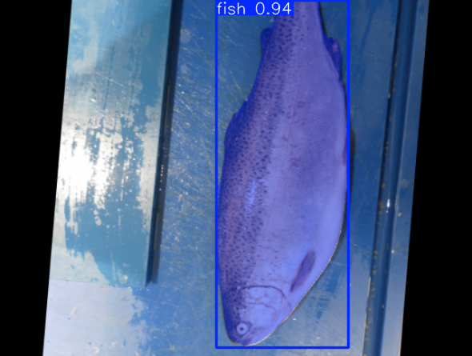
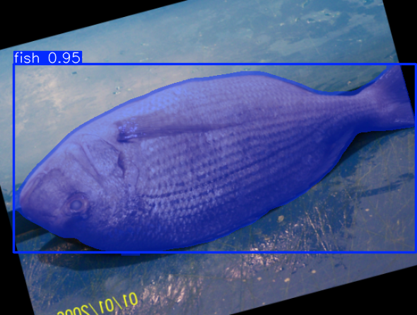
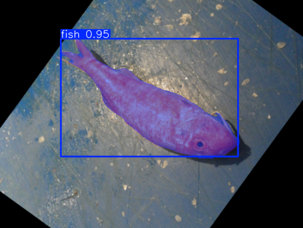
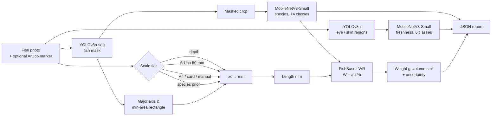
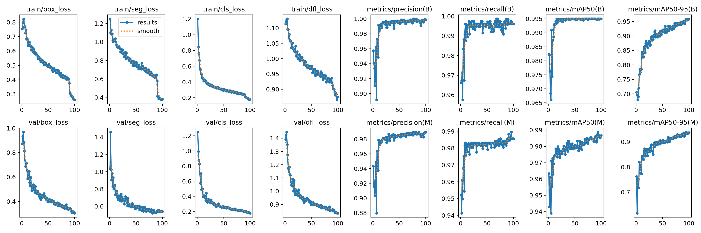
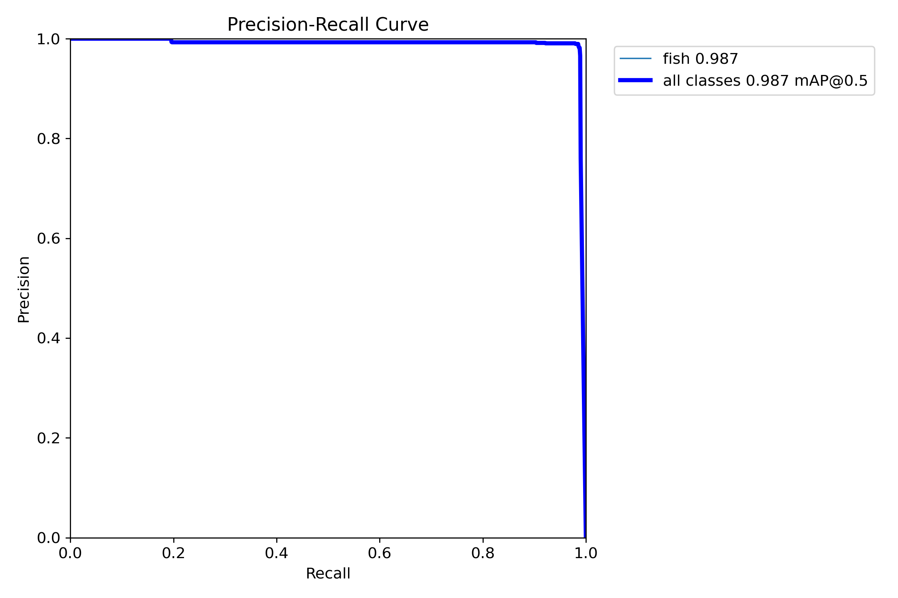
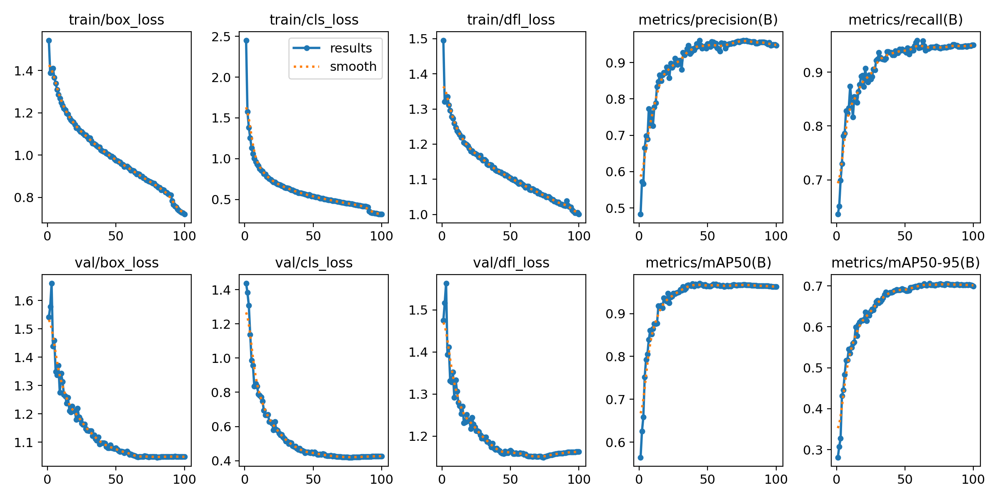
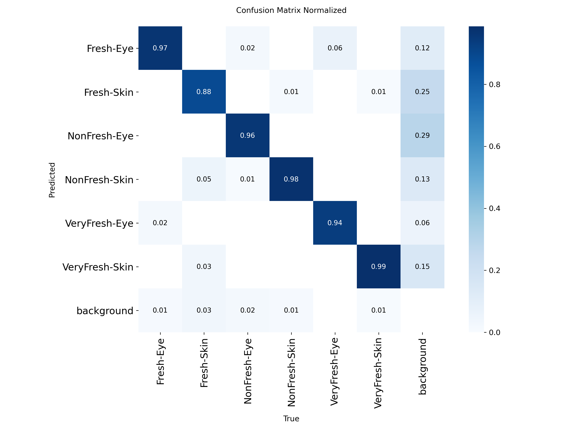

# MATSYA: Fish Segmentation, Species, Freshness and Weight Estimation

> Computer-vision pipeline that segments a fish in a photo, identifies the species, grades freshness from eye/skin regions, and estimates length and weight using an ArUco scale marker and FishBase length–weight relationships.


<p align="center">
  
  
  
</p>

## Contents

- [Overview](#overview)
- [Highlights](#highlights)
- [Pipeline](#pipeline)
- [Results](#results)
- [Tech stack](#tech-stack)
- [Project structure](#project-structure)
- [Getting started](#getting-started)
- [Datasets](#datasets)
- [Limitations](#limitations)
- [Related repositories](#related-repositories)
- [License](#license)

## Overview

**Problem.** At fish markets and landing centres, species, freshness and weight are judged by eye. MATSYA explores whether a single phone photo can give all three.

**Approach.** Four models are chained: a YOLOv8n-seg model isolates the fish, a MobileNetV3-Small classifier names the species from the masked crop, a YOLOv8n detector finds eye and skin regions which a MobileNetV3-Small classifier grades into three freshness levels, and a measurement module converts the mask's major axis to millimetres (ArUco marker or fallback scale) and then to grams with a species-specific length–weight relationship `W = a·L^b` scraped from FishBase.

**Result.** On held-out validation splits the segmentation model reaches **0.938 mask mAP50-95**, the species classifier **98.5 % accuracy (14 classes)**, the freshness detector **0.966 mAP50**, and the freshness crop classifier **96.9 % accuracy (6 classes)**. Weight estimation is implemented end to end but has not been validated against scale-measured fish (see [Limitations](#limitations)).

## Highlights

- **Instance segmentation** with YOLOv8n-seg trained on polygon labels generated from the Large-Scale Fish Dataset's GT masks (`scripts/make_yolo_seg.py`).
- **Species classifier** (MobileNetV3-Small, two-stage warm-up + fine-tune, class-balanced sampling) on segmentation-based crops of Indian market fish.
- **Two-stage freshness grading**: YOLOv8n localises eye/skin regions, MobileNetV3-Small grades each crop as Very Fresh / Fresh / Not Fresh, exported to ONNX.
- **Multi-tier scale calibration**: depth (ARCore, if available) → 50 mm ArUco marker → A4 / card rectangle → manual two-point reference → species length prior, each with a quality score that feeds an uncertainty estimate.
- **FishBase length–weight scraper** (`scripts/fishbase_lw_scrape.py`) producing an LWR table covering 7,285 species used for weight and volume (`V = W / ρ`, ρ = 1.04 g/cm³).

## Pipeline



## Results

All numbers come from the training logs and notebook outputs committed in this repo (`runs/*/results.csv`, `notebooks/02_training.ipynb`, `notebooks/07_evaluation_report.ipynb`).

| Model | Task | Data (val) | Metric |
|---|---|---|---|
| YOLOv8n-seg (`runs/segment/train`) | Fish segmentation, 1 class | 767 images | Box mAP50 **0.995**, mAP50-95 **0.960**; Mask mAP50 **0.987**, mAP50-95 **0.938** |
| MobileNetV3-Small (`models/species_cls`) | Species, 14 classes | 15 % random split (1,355 crops) | Best val accuracy **98.5 %** |
| YOLOv8n (`runs/detect/fish_freshness_yolov85`) | Eye/skin freshness regions, 6 classes | 475 images / 940 boxes | P 0.954, R 0.944, mAP50 **0.966**, mAP50-95 **0.707** |
| MobileNetV3-Small (`models/freshness_cls`) | Freshness crop classifier, 6 classes | 940 crops | Accuracy **96.9 %**, macro-F1 0.961 |

Segmentation inference: 3.6 ms per image at 640 px on an RTX 3050 Ti Laptop GPU (Ultralytics validation log).

<details>
<summary><b>Freshness classifier: per-class report</b></summary>

| Class | Precision | Recall | F1 | Support |
|---|---|---|---|---|
| Fresh-Eye | 0.957 | 1.000 | 0.978 | 90 |
| Fresh-Skin | 0.872 | 0.863 | 0.868 | 95 |
| NonFresh-Eye | 1.000 | 0.991 | 0.995 | 323 |
| NonFresh-Skin | 0.963 | 0.968 | 0.965 | 216 |
| VeryFresh-Eye | 1.000 | 0.984 | 0.992 | 62 |
| VeryFresh-Skin | 0.968 | 0.968 | 0.968 | 154 |
| **Macro avg** | 0.960 | 0.962 | 0.961 | 940 |

Skin crops in the middle "Fresh" grade are the hardest class, which matches how gradual the visual change is.
</details>

<details>
<summary><b>Freshness detector: per-class mAP</b></summary>

| Class | P | R | mAP50 | mAP50-95 |
|---|---|---|---|---|
| Fresh-Eye | 0.894 | 0.967 | 0.951 | 0.660 |
| Fresh-Skin | 0.956 | 0.895 | 0.954 | 0.737 |
| NonFresh-Eye | 0.973 | 0.947 | 0.957 | 0.628 |
| NonFresh-Skin | 0.955 | 0.972 | 0.981 | 0.746 |
| VeryFresh-Eye | 0.974 | 0.935 | 0.963 | 0.674 |
| VeryFresh-Skin | 0.973 | 0.948 | 0.990 | 0.795 |
</details>

<details>
<summary><b>Training curves and confusion matrices</b></summary>

**Segmentation (YOLOv8n-seg, 100 epochs)**




**Freshness detector (YOLOv8n, 100 epochs)**



</details>

<details>
<summary><b>Example pipeline output</b></summary>

`results/sample_analysis_black_pomfret.json` is the output for one test image. No scale marker was present, so the length came from the species prior (`scale_mode: "none"`, `q_scale: 0.2`) and the reported relative weight error is ±66 %. With an ArUco marker in frame the notebook's sanity check measures 11.8 px/mm at quality 1.0.

```json
{
  "species": "Black Pomfret", "species_conf": 1.0,
  "freshness": "fresh", "fresh_conf": 0.894,
  "length_mm": 350.0, "weight_g": 643.1, "volume_cm3": 618.4,
  "scale_mode": "none", "q_scale": 0.2, "lwr_mode": "fultonK",
  "uncertainty": { "length_relative_error": 0.22, "weight_relative_error": 0.66 }
}
```
</details>

## Tech stack

| Area | Tools |
|---|---|
| Detection / segmentation | Ultralytics YOLOv8n, YOLOv8n-seg |
| Classification | PyTorch, torchvision MobileNetV3-Small (species and freshness heads) |
| Measurement | OpenCV (ArUco `DICT_4X4_50`, `minAreaRect`, contours), NumPy |
| Length–weight data | requests + BeautifulSoup scraper over FishBase, pandas |
| Export | ONNX (freshness detector and classifier) |
| Evaluation | scikit-learn, matplotlib, seaborn |

## Project structure

```text
MATSYA/
├── assets/
│   ├── aruco_50mm_id23_300dpi.png     # printable 50 mm scale marker (print at 100 %)
│   ├── fish_lwr.csv                   # LWR parameters fitted from raw (L, W) pairs, 161 species
│   ├── fishbase_lwr.csv               # cleaned FishBase LWR table, one row per species (7,285)
│   └── fishbase_lw_raw.xlsx           # raw scraper output
├── configs/
│   └── fish_seg.yaml                  # YOLO-seg dataset config (data/YOLO_FISH_SEG)
├── models/
│   ├── freshness_cls/                 # MobileNetV3-Small 6-class freshness (.pt + .onnx)
│   └── species_cls/                   # MobileNetV3-Small species (best + last)
├── notebooks/
│   ├── 01_dataset_prep.ipynb          # GT masks → YOLO polygons, species crops via the seg model
│   ├── 02_training.ipynb              # seg, species, freshness-detector training; LWR cleaning; measurement code
│   ├── 03_freshness_mobilenet.ipynb   # YOLO boxes → crops, MobileNetV3-Small training, ONNX export
│   ├── 04_pipeline_demo.ipynb         # first end-to-end demo
│   ├── 05_evaluation_v2.ipynb         # evaluation + measurement pipeline v2
│   ├── 06_evaluation_v2_advanced.ipynb# extended analytics plots
│   └── 07_evaluation_report.ipynb     # final evaluation run (metrics quoted above)
├── results/
│   └── sample_analysis_black_pomfret.json
├── runs/
│   ├── segment/train/                 # YOLOv8n-seg run: weights, curves, results.csv
│   ├── segment/predict/               # sample mask predictions
│   └── detect/fish_freshness_yolov8*/ # freshness detector runs (yolov85 is the final 100-epoch run)
├── scripts/
│   ├── fishbase_lw_scrape.py          # FishBase length–weight scraper
│   └── make_yolo_seg.py               # mask → YOLO-seg label converter
├── requirements.txt
└── LICENSE
```

## Getting started

**Prerequisites:** Python 3.11, a CUDA GPU for training (inference works on CPU).

```bash
git clone https://github.com/rupeshbharambe24/MATSYA.git
cd MATSYA
python -m venv .venv && source .venv/bin/activate   # Windows: .venv\Scripts\activate
pip install -r requirements.txt
```

**Run a trained model on your own images** (weights are in the repo):

```bash
yolo segment predict model=runs/segment/train/weights/best.pt source=path/to/fish.jpg
yolo detect  predict model=runs/detect/fish_freshness_yolov85/weights/best.pt source=path/to/fish.jpg
```

**Reproduce training / evaluation:** put the datasets under `data/` (see below), then open the notebooks. Each notebook starts with a cell that switches to the repo root, so they can be run from `notebooks/` directly.

```bash
python scripts/make_yolo_seg.py            # data/LARGE SCALE FISH DATASET → data/YOLO_FISH_SEG
jupyter lab notebooks/02_training.ipynb
```

**Rebuild the length–weight table:**

```bash
python scripts/fishbase_lw_scrape.py --out assets/fishbase_lw_raw.xlsx --delay 1.0
# then run the "LWR cleaning" cell in notebooks/02_training.ipynb → assets/fishbase_lwr.csv
```

Print `assets/aruco_50mm_id23_300dpi.png` at 100 % scale and place it next to the fish, in the same plane, to get the high-confidence scale tier.

## Datasets

The datasets are not committed (`data/` is git-ignored). The notebooks expect:

| Path under `data/` | Used for | Source |
|---|---|---|
| `LARGE SCALE FISH DATASET/` → `YOLO_FISH_SEG/` | Segmentation (images + GT masks → polygons) | Large-Scale Fish Dataset (Ulucan et al., 2020, Kaggle) |
| `Indian Seafood Fish Dataset/`, `pak fishes dataset/` → `species_crops/` | Species classifier | Public Indian / Pakistani market-fish image sets |
| `Fish Freshness-eyes-skin/` (YOLO format) → `freshness_crops_cls/` | Freshness detector + classifier | Fish freshness eye/skin detection dataset (YOLO export) |

Check each dataset's licence before redistributing it. FishBase data (`assets/fishbase_*`) is published by FishBase under CC BY-NC; cite FishBase (Froese & Pauly, www.fishbase.org) when reusing it.

## Limitations

- **Weight is not validated.** No set of fish with scale-measured weights was available, so `weight_g` is a model of weight, not a measured accuracy. Without a scale marker the length comes from a species prior and the error is large (±66 % in the sample output).
- The species split is a random 15 % split of crops, so near-duplicate images of the same fish can appear in train and validation; real-world accuracy will be lower.
- Two species folders (`Indian Carp` and `Indian-Carp`) are separate classes in the trained model due to inconsistent folder names in the source data.
- The ARCore depth tier is implemented as a function but was never exercised with real depth maps in these notebooks.

## Related repositories

| Repository | Role |
|---|---|
| **MATSYA** (this repo) | ML models, measurement pipeline, training notebooks |
| [matysa-aqua-insight](https://github.com/rupeshbharambe24/matysa-aqua-insight) | Web UI prototype for the MATSYA app |

## License

Code is released under the [MIT License](LICENSE). Datasets and FishBase-derived tables keep their original licences.
